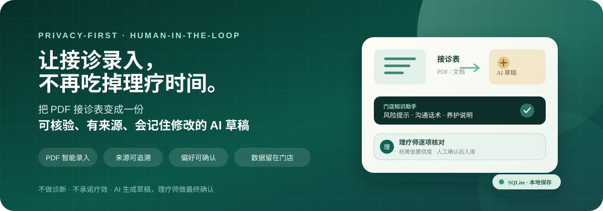
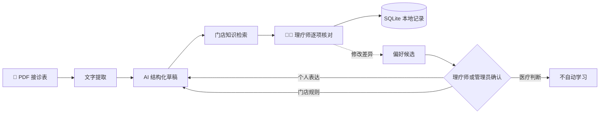

<div align="center">
  

  <h1>理疗门店 AI 接诊工作台</h1>

  <p><strong>让纸质接诊表变成一份可核验、有来源、会记住修改的 AI 草稿。</strong></p>

  <p>
    
    
    
    
  </p>

  <p>
    <a href="#quick-start">快速运行</a> ·
    <a href="#workflow">工作流程</a> ·
    <a href="#capabilities">核心能力</a> ·
    <a href="#safety">安全边界</a>
  </p>
</div>

> [!IMPORTANT]
> 这是一个可运行原型，不是医疗诊断产品。AI 只生成录入草稿和知识参考，所有客户记录、疗程扣次与医疗判断都必须由理疗师确认。

## 一分钟看懂

理疗师每天真正耗时的，往往不是“缺少一个聊天框”，而是这些重复工作：

> 抄接诊表、核数字、补记录、找门店规则、写顾客说明、安排复诊。

这个项目把上述动作串成一条可追溯的工作流：

| 以前 | 现在 |
| --- | --- |
| 对着纸质表逐项手抄 | 上传 PDF，自动生成客户与接诊草稿 |
| 凭记忆查找门店规范 | 从本地知识库检索，并展示来源与原文 |
| 每次都要重复修改同样的格式 | 从修改样本中发现候选偏好，确认后再应用 |
| 让 AI 直接给出医疗结论 | 确定性安全规则拦截，理疗师做最终决定 |

<details>
<summary><strong>展开查看完整功能清单</strong></summary>

- 门店 Markdown 本地知识检索
- 权威来源分级、候选重排与冲突处理
- 风险规则与禁忌资料查询
- 客户级纵向记忆与独立接诊调查时间线
- PDF 接诊表智能提取、人工核对和确认入库
- PDF 人工修改逐字段留痕与建议分类
- 重复表达修改的个人偏好与管理员确认的门店规则
- PDF 草稿的有来源风险、沟通、养护与门店规则辅助
- 今日工作台：预约、待复诊、次数不足、近期风险和上次接诊
- 独立预约管理：按日期和时段为不同客户安排预约
- 完整数据库备份、加密归档、恢复校验和每日自动备份
- 离线 PWA 壳缓存和本地数据访问
- 受治理工具层、权限校验、写操作确认和调用审计
- 本地检索、写入事务和回归测试

</details>

<a id="workflow"></a>
## 它怎样工作



**关键不是让 AI 一次做对，而是让每一次修改都留下可追溯的线索。**

<a id="capabilities"></a>
## 四个核心能力

| 能力 | 理疗师看到什么 | 关键设计 |
| --- | --- | --- |
| 📄 智能录入 | PDF 原文与结构化字段并排核对 | 低置信度字段标黄，确认后才入库 |
| 🔎 有来源助手 | 风险提示、沟通话术、养护说明、规则补全 | 每项显示来源、权威等级和原文摘录 |
| 🧠 偏好记忆 | “是否记住这类修改？” | 仅学习表达格式与固定规则，医疗判断不自动学习 |
| 🛡️ 门店工作台 | 今日预约、待复诊、次数不足、近期风险 | 权限隔离、写入确认、操作审计、加密备份 |

<a id="safety"></a>
## 安全边界，不是宣传语

- **AI 不做诊断**：不推断疾病、不解读影像、不承诺疗效。
- **AI 不直接写库**：生成结果只是草稿，理疗师确认后才进入正式记录。
- **AI 不决定扣次**：疗程次数必须走接诊完成确认。
- **知识没有来源就不回答**：知识库未命中时明确拒绝补写。
- **门店规则必须审核**：管理员批准后才会影响下一次生成。
- **客户数据默认留在本地**：在线模型只接收经过处理的最小必要文本。

> 风险规则是确定性的第一道闸门；AI 是录入与整理工具，不是医疗决策者。

<a id="quick-start"></a>
## 快速启动

本机已经具备 Python 3.11 和所需运行依赖时，直接执行：

```powershell
Copy-Item .env.example .env
python -m uvicorn app.main:app --reload
```

浏览器打开 <http://127.0.0.1:8000>。

顾客只读网页：

<http://127.0.0.1:8000/customer/>

也可以执行：

```powershell
.\start.ps1
```

首次换到其他电脑时，先安装依赖：

```powershell
python -m venv .venv
.\.venv\Scripts\Activate.ps1
python -m pip install -r requirements.txt
Copy-Item .env.example .env
python -m uvicorn app.main:app --reload
```

仓库不包含真实门店知识库。首次演示可以先复制脱敏示例：

```powershell
New-Item -ItemType Directory -Force data\knowledge
Copy-Item .\examples\knowledge\*.md .\data\knowledge
```

AI 聊天仍然停用。目前只接通了 PDF 智能录入：上传有文字层的 PDF 后，系统生成客户和接诊草稿，必须由理疗师核对确认才会写入数据库。未配置模型时自动使用本地字段规则，不影响手工录入。

<details>
<summary><strong>高级配置：接入在线 AI、偏好记忆与知识助手</strong></summary>

### 配置 PDF 智能录入

```dotenv
LLM_PROVIDER=deepseek
LLM_API_KEY=在门店电脑本地填写
LLM_BASE_URL=https://api.deepseek.com/v1
LLM_MODEL=deepseek-chat
LLM_MAX_OUTPUT_TOKENS=1800
# 默认脱敏后再发送给模型
LLM_SEND_PII=false
```

也可以使用 `LLM_PROVIDER=openai-compatible` 并填写兼容 OpenAI Chat Completions 的地址、密钥和模型。将 `LLM_PROVIDER` 留为 `demo` 时，PDF 功能使用本地规则提取，不访问外网。

默认会先在本地提取姓名、电话和地址，再把文本中的身份信息替换后交给模型。正式启用前应同步更新 `.env` 中的隐私用途说明。

### PDF 偏好记忆

系统从最近的人工修改样本中寻找同类表达修改。同类修改至少出现 2 次后，理疗师可以选择：

- 仅本次：不再提示这一条偏好建议。
- 记住表达格式：立即作为当前理疗师个人偏好生效。
- 提交门店管理员确认后作为门店规则：创建待审核规则，管理员批准后才生效。

当前只有表达格式、固定告知语和固定操作规则允许进入偏好候选，例如客户备注、告知登记、复诊备注和接诊类型。客户事实变更和检查记录、风险提示、调理方案等医疗判断不会自动学习。

已生效偏好只注入下一次在线 AI 提取。本地规则模式不受偏好影响，并会在解析结果中提示。门店规则优先于个人偏好，但两者均不得改变风险判断或补造原文不存在的事实。

### PDF 有来源知识助手

PDF 草稿生成后，系统会围绕当前主诉、风险和门店操作场景检索本地知识库，并分别提供：

- 风险问题提示
- 顾客沟通话术
- 顾客版养护说明
- 门店接诊记录填写规则补全

在线 AI 会基于检索结果整理文本，本次使用的知识片段会随草稿保存。每个项目显示标题、来源文件、权威等级和原文摘录。某个主题没有检索结果时，该项固定返回“该内容不在门店知识库范围内，无法提供参考。”，不会让模型自行补充。

本地规则模式仍会展示来源和安全风险提醒，但不会自动改写顾客沟通稿或顾客版养护说明。所有结果在确认入库前仅供理疗师核对。

</details>

如果暂时不部署云服务器，可以使用“门店电脑 + 固定域名 HTTPS 内网穿透”做试点。先在当前电脑运行 `.\start-public.ps1`，再让正规隧道服务转发到 `http://127.0.0.1:8000`。完整安全要求和验收步骤见 [PUBLIC-PILOT.md](./PUBLIC-PILOT.md)。公网模式下必须通过 HTTPS 隧道访问，电脑关机、断网或睡眠后网站会停止服务。

## 顾客只读网页端

理疗师在客户快速卡中点击“生成顾客网页邀请码”，将网页链接和一次性邀请码线下发给客户。

客户流程：

```text
打开 /customer/
  -> 阅读用途、保存期限、删除规则和隐私联系人
  -> 主动勾选同意
  -> 输入邀请码、手机号后四位、设置密码
  -> 绑定自己的客户档案
  -> 登录后查看自己的套餐次数、预约、复诊和顾客版接诊摘要
  -> 展开查看自己的居家养护说明
  -> 选择日期查看理疗师的可预约、已预约和不可预约时段
```

顾客只能读取自己的健康资料。顾客可以修改登录密码、解绑网页账号或提交资料删除申请，但不能修改接诊、预约和扣次记录，也不能查看：

- 其他客户
- 内部现病史、查体、风险评估和完整病例
- 员工工作台
- 接诊写入与扣次
- 知识库和工具
- 备份恢复

顾客日程页只显示时段状态，不显示其他预约客户姓名。自己的预约会显示“您的预约”。

邀请码 24 小时有效、使用一次后失效。顾客密码使用 scrypt 加盐哈希保存，登录状态使用 HttpOnly Cookie。

### 注册隐私同意

顾客注册页会先读取并展示当前隐私说明。用途、保存期限、删除规则或隐私联系人为空时，注册会被阻止。后端要求请求明确携带 `privacy_consent=true`，未同意时不会创建账号。

每次成功注册都会在同一数据库事务中写入 `privacy_consents`，保存：

- 顾客编号和账号编号
- 政策版本和同意时间
- 当时展示的处理用途、保存期限、删除规则和联系人原文

政策以后修改时应提升 `PRIVACY_POLICY_VERSION`。历史记录保存的是同意当时的文本，不会随配置变化。顾客登录后可通过 `GET /api/portal/privacy-consent` 读取自己的最近一次同意记录。

注册前必须在 `.env` 配置真实的隐私联系人：

```dotenv
PRIVACY_POLICY_VERSION=2026-11-15-v1
PRIVACY_PURPOSE=用于建立和管理客户档案，安排预约、接诊与复诊，提供顾客网页查询，并用于加密备份、安全审计和服务质量改进；不用于广告营销，不向大模型发送个人健康信息。
PRIVACY_RETENTION=在服务期间及最后一次业务联系后3年内保存；到期后删除或匿名化。法律法规、监管或争议处理另有要求时按要求延长。
PRIVACY_DELETION_RULE=可联系门店隐私联系人申请查询、更正、导出或删除个人资料。身份核验后删除账号、隐私同意记录、客户档案、接诊、预约、复诊和养护说明；系统内加密备份副本最迟在30天备份保留期结束后清理，另行导出的介质由门店按同一期限销毁并留痕。
PRIVACY_CONTACT=门店隐私负责人 手机或邮箱
```

顾客账号安全流程：

- 登录后输入当前密码即可修改密码，修改后其他设备上的旧会话立即失效。
- 忘记密码时不使用手机号后四位直接重置。理疗师先在“顾客网页账号”中核验顾客身份，再生成 30 分钟有效的一次性找回码。
- 顾客可以自行解绑网页账号。解绑不会删除门店接诊档案，之后可由理疗师重新生成邀请码绑定。
- 顾客可以申请删除个人资料。申请进入理疗师处理队列，不会自动删除；理疗师同意后会清除网页账号、客户身份资料、接诊、预约、复诊和养护说明，并释放未完成预约时段。
- 理疗师可以撤销顾客网页账号，撤销后现有会话立即失效；误操作时可以恢复账号。
- 已有备份文件是历史副本，删除线上资料不会自动清除旧备份。正式门店应制定备份保留和销毁规则。

如果服务要开放到门店局域网或公网，必须在 `.env` 设置长随机员工密码：

```dotenv
STAFF_ACCESS_PASSWORD=change-to-a-long-random-password
STAFF_ADMIN_USERNAME=admin
PORTAL_COOKIE_SECURE=true
```

未设置员工密码时，员工 API 只允许本机访问，防止公开顾客网页后意外暴露管理接口。使用 HTTPS 部署时必须把 `PORTAL_COOKIE_SECURE` 设为 `true`。

`STAFF_ACCESS_PASSWORD` 用于首次创建管理员账号。初始管理员登录名为 `STAFF_ADMIN_USERNAME`，默认 `admin`。管理员登录后可以：

- 创建普通理疗师或管理员账号
- 停用和重新启用员工账号
- 查看员工操作记录
- 在侧边栏退出员工登录

普通理疗师不能访问员工账号管理、员工审计、完整备份恢复和 Excel 全量导出。停用员工后，该员工现有登录会话会立即失效。

员工所有业务 API 操作都会记录员工账号、角色、请求方式、接口、状态码和时间，方便追溯由哪位员工新增或修改记录。

登录防护同时作用于员工端和顾客端：

- 同一账号和同一 IP 连续输错密码后，等待时间按 2 秒、5 秒、10 秒、30 秒、60 秒逐步增加。
- 15 分钟内同一账号累计 8 次失败会锁定约 10 分钟。
- 15 分钟内同一 IP 累计 30 次失败会锁定约 15 分钟。
- 被限制的请求返回 HTTP `429` 和 `Retry-After`，不会继续校验密码。
- 每次成功或失败登录都写入登录记录；管理员可在员工管理中的“失败登录记录”查看时间、账号、IP、失败原因和等待时间。

## 目录结构

```text
app/
  agent/
    orchestrator.py       Agent 主流程
    prompt_builder.py     系统提示词与本轮风险约束
    safety.py             红线规则、风险识别、输出复核
  knowledge/
    base.py               知识库接口
    local_markdown.py     本地 Markdown 分块与 BM25 检索
    policy.py             来源权威等级与类型策略
    reranker.py           相关度、权威、意图和章节重排
    conflicts.py          来源方向冲突识别与保守解析
  llm/
    base.py               模型提供方接口
    demo.py               离线演示模型
    openai_compatible.py  OpenAI 兼容模型适配器
  sessions/
    base.py               会话存储接口
    memory.py             进程内会话实现
  memory/
    base.py               客户纵向记忆接口
    models.py             客户主档与接诊调查模型
    sqlite_store.py       SQLite 持久化和客户隔离
  tools/
    base.py               工具协议、执行上下文和错误类型
    registry.py           工具注册、发现和模型 Schema
    governance.py         服务端权限与客户范围策略
    executor.py           参数校验、超时、执行和审计
    knowledge.py          门店知识检索工具
    customer.py           客户档案与记忆读取工具
    audit.py              内存/SQLite 工具审计
    factory.py            默认工具装配
  config.py               环境配置
  domain.py               API 数据模型
  main.py                 FastAPI 入口
data/
  system_prompt.md        最高优先级系统约束
  knowledge/              可检索的门店知识
  knowledge_policy.json   来源权威分级配置
  evaluations/            与知识库隔离的测评集
  customer_memory.sqlite3 客户档案与接诊记录（运行后生成）
  tool_audit.sqlite3      工具调用审计（运行后生成）
web/                      无构建步骤的前端
tests/                    安全、检索、编排、测评回归测试
```

## 处理流程

```text
检索关键词
  -> 本地 Markdown 分块
  -> BM25 候选召回
  -> 权威等级与问题意图重排
  -> 冲突识别
  -> 返回原始知识片段 + 来源 + 免责声明
```

知识内容不经过大模型改写，理疗师可以直接核对原始门店资料。

## 替换与扩展

| 要增加的能力 | 建议修改位置 |
| --- | --- |
| 更新门店知识 | 编辑 `data/knowledge/*.md` 后重启 |
| 增加安全规则 | `app/agent/safety.py` 的 `REDLINE_RULES` / `RISK_PATTERNS` |
| 接入向量数据库 | 实现 `app/knowledge/base.py` 中的 `KnowledgeBase` 协议 |
| 接入其他模型 | 实现 `app/llm/base.py` 中的 `LLMProvider` 协议 |
| 持久化会话 | 实现 `app/sessions/base.py` 中的 `SessionStore` 协议 |
| 增加工具调用 | 在 `AgentOrchestrator` 的检索前后增加独立 Tool Registry |
| 做客户侧入口 | 复用编排层，新增独立的客户侧提示词与更严格输出策略 |

知识库没有的内容会直接返回“该内容不在门店知识库范围内，无法提供参考”，以减少价格、项目和规则幻觉。

## 客户纵向记忆

客户记忆与 RAG 门店知识完全分开。客户主档除基础资料外，还包含客户现存问题、历史病例、所选疗程和疗程剩余次数：

```text
客户长期记忆：customer_id，保存客户主档
接诊调查记忆：customer_id + investigation_id，保存每次接诊记录
预约与复诊：customer_id 关联的独立任务
门店知识：data/knowledge，供本地搜索使用
```

每个接诊记录依据门店模板保存主诉、持续时长、诱发因素、现病史、既往史问询、女性专项、查体记录、风险评估、调理方案、告知登记、签字和复诊备注。

隔离规则：

- 每次客户数据请求都必须指定当前客户，服务端不会跨客户读取。
- 接诊记录查询始终带 `WHERE customer_id = ?`，不会跨客户召回。
- 客户数据保存在 `data/customer_memory.sqlite3`，不写入 RAG 索引。

页面顶部“当前客户”按钮用于选择客户、新建客户和维护接诊调查。数据库中客户记录的示例结构可通过以下接口查看：

- `GET /api/customers`
- `POST /api/customers`
- `GET /api/customers/{customer_id}`
- `PATCH /api/customers/{customer_id}`
- `GET /api/customers/{customer_id}/investigations`
- 接诊记录通过 `/visits/prepare` 和 `/visits/confirm` 两阶段写入
- `DELETE /api/customers/{customer_id}/investigations/{investigation_id}`

客户快速卡会在打开档案时优先展示：

- 现存问题和历史病例
- 主要风险及风险等级
- 所选疗程和剩余次数
- 上次主诉和最近复诊反馈
- 最近一次危险信号及记录日期

完整的现存问题、历史病例和接诊时间线保持折叠，需要时展开。危险信号从已保存记录中提取，并忽略“无夜间痛”“无放射麻木”等否定描述。

## 测评与 RAG 调优

原始测评集已转换为结构化数据：

[`data/evaluations/core_cases.json`](data/evaluations/core_cases.json)

RAG 专项回归集：

[`data/evaluations/rag_regression_cases.json`](data/evaluations/rag_regression_cases.json)

它覆盖 8 个类别、19 个用例，并分别检查：

- 安全拦截和风险等级
- RAG 是否召回指定知识关键词
- 最终回答是否包含关键知识点
- 是否返回知识来源与免责声明
- 是否出现禁止内容

只测试安全规则和 RAG，不调用模型：

```powershell
python -m app.evaluation.cli --retrieval-only
```

运行完整链路，包括最终回答：

```powershell
python -m app.evaluation.cli
```

运行权威来源、重排、冲突和来源命中专项回归：

```powershell
python -m app.evaluation.cli --cases data/evaluations/rag_regression_cases.json --retrieval-only
python -m app.evaluation.cli --cases data/evaluations/rag_regression_cases.json
```

按分类或单个用例调试：

```powershell
python -m app.evaluation.cli --retrieval-only --category 价目
python -m app.evaluation.cli --case-id 5-1
```

保存机器可读报告，便于调整 RAG 前后对比：

```powershell
python -m app.evaluation.cli --json-output data/evaluations/reports/current.json
```

调 RAG 时先跑 `--retrieval-only`，确认召回没有退化，再跑完整评测检查模型回答。测评目录不在 `KNOWLEDGE_DIR` 内，不会进入 RAG；系统提示词也不会被索引。

### 来源权威分级

`data/knowledge_policy.json` 独立维护来源等级，不将策略硬编码进检索器：

| 等级 | 当前来源 | 用途 |
| --- | --- | --- |
| A | 正骨风险接诊自查、门店经营类 | 门店安全规则和经营规则 |
| B | 接诊记录沟通模板、居家养护宣教 | 门店操作模板和宣教 |
| C | 理疗师内部学习笔记 | 解剖、评估和内部培训 |
| D | 未登记来源 | 默认低权重，等待治理 |

主检索流程改为两阶段：

```text
BM25 扩大候选池
  -> 混合重排（词面相关度 + 权威等级 + 问题意图 + 标题覆盖）
  -> 单来源多样性限制
  -> 来源冲突识别
  -> Top-K 注入模型
```

风险、禁忌和基础病问题会优先安全规则；价格、套餐和预约问题优先经营规则；沟通和复诊问题优先门店模板；解剖与评估问题优先内部学习资料。

当不同来源对同一主题分别出现“可以/适合”和“禁止/避免”时，系统生成冲突元数据。A 级安全规则优先于低等级来源；同等级冲突采用限制更强、范围更保守的表述，并明确提示条件差异。

回归报告新增：

- Top-1 来源是否匹配
- Top-K 是否命中期望来源
- 命中率 Hit@K
- 平均倒数排名 MRR
- Top-1 最低权威等级
- 预期冲突识别是否准确

## 受治理工具层

当前注册的工具：

- `search_store_knowledge`：检索门店公共知识
- `get_customer_profile`：读取当前客户主档
- `get_customer_memory`：读取当前客户的纵向接诊记忆
- `prepare_visit_completion`：生成待确认的接诊完成草稿
- `confirm_visit_completion`：确认后保存接诊、扣减次数并创建复诊任务
- `schedule_customer_appointment`：为当前客户安排预约

Agent 的知识检索、客户记忆读取和接诊写入均通过统一工具执行器，不再由模型直接访问底层存储。每次调用经过：

```text
工具注册与白名单
  -> 服务端角色/权限校验
  -> 客户范围校验
  -> JSON Schema 参数校验
  -> 超时控制
  -> 执行
  -> 审计记录
```

客户 `customer_id` 只能来自服务端当前请求上下文，工具参数模型禁止模型自行注入 `customer_id`。审计日志写入 `data/tool_audit.sqlite3`，查询文本只记录 SHA-256 摘要和长度，不记录原文。

### 接诊完成写流程

```text
填写接诊表单
  -> prepare_visit_completion 生成 10 分钟有效的一次性确认令牌
  -> 页面展示：当前剩余、本次使用、扣后剩余、复诊日期
  -> 理疗师点击“我确认，执行并保存”
  -> confirm_visit_completion 校验令牌、客户范围和当前余额
  -> 单事务保存接诊记录 + 扣减剩余次数 + 创建复诊任务
```

防错规则：

- 未确认时不会写客户记录，也不会扣次数。
- 确认令牌一次性使用，重复确认不会重复扣次。
- 生成确认后剩余次数发生变化，旧令牌失效并要求重新确认。
- 剩余次数不足时直接拒绝。
- 风险评估为绝对禁忌时不能借完成接诊扣减次数。
- 高风险情形只能记录本次情况，不能扣疗程次数。
- 写入和确认调用均进入工具审计。

查看当前注册的工具：

```powershell
Invoke-RestMethod http://127.0.0.1:8000/api/tools
```

模型仍不能自动选择工具。接诊完成和扣次必须由理疗师界面显式确认；预约录入通过受治理写工具执行。

## 今日工作台

首页默认进入今日工作台，聊天作为独立咨询视图保留。工作台按当前 SQLite 客户数据实时聚合：

- 今日预约客户和预约时间
- 到期或逾期的复诊任务
- 所选疗程剩余次数低于 `LOW_SESSION_THRESHOLD` 的客户
- 最近 `RISK_LOOKBACK_DAYS` 天内出现风险标记的客户
- 每位客户的上次接诊摘要
- 最近接诊客户摘要

侧边栏、工作台或手机顶部进入“预约管理”。预约不再依赖先打开某个客户档案：

- 选择预约日期
- 设置当天开始时间、结束时间和每个时段的间隔
- 点击“生成 / 更新时段”
- 点击一个可预约的具体时间段
- 搜索并选择不同客户，填写预约项目和备注
- 可关闭空闲时段，也可重新开放

已预约时段会锁定并显示客户姓名，不能重复预约或关闭。重新调整当天排班不会删除已有预约。

预约管理页和当天预约清单中可以：

- 标记为已完成：时段变为“已完成”，不能再次预约
- 取消预约：时段自动释放为“可预约”

复诊任务可以标记：

- 已完成复诊
- 电话回访完成
- 顾客暂时不来
- 任务取消

暂时不来的任务可以从客户档案恢复为待复诊；已完成和已取消任务进入历史，不再出现在今日待复诊列表。

```dotenv
LOW_SESSION_THRESHOLD=2
RISK_LOOKBACK_DAYS=30
```

## 手机端优先操作

- 工作台提供手机号后四位快速查找客户。
- 移动端按钮和表单控件使用更大的触控区域。
- 接诊表单默认隐藏现病史、既往史、查体等补充字段，点击“补充更多信息”再展开。
- 知识检索已合并到今日工作台，直接在首页输入关键词并查看来源。
- 助手回复和客户快速卡提供“复制顾客版”，复制后由理疗师手动粘贴到微信。
- 顾客版话术由固定合规模板生成，不包含内部风险分析或疗效承诺。
- 客户快速卡支持生成并打印居家养护说明。
- 顾客网页中的养护说明使用可展开卡片，默认收起，不提供直接打印入口。

当前不连接微信自动发送接口，避免账号权限、误发和平台规则风险。

## 数据备份与恢复

页面“备份与恢复”入口支持：

- 一键导出客户数据库和工具审计数据库的完整快照
- 所有新备份强制使用至少 8 位密码进行 AES-GCM 加密
- 查看和下载本地手动/每日备份
- 上传备份后先校验格式、SHA-256、SQLite 完整性和必要表结构
- 预览客户、接诊、预约和复诊数量后再确认恢复
- 恢复前自动生成当前数据安全回滚备份

### 理疗师 Excel 数据表

同一页面提供“导出全部业务数据 Excel”：

- 导出说明
- 客户总表
- 接诊记录
- 预约记录
- 复诊任务
- 自定义养护说明

Excel 只用于电脑查看、统计和人工整理，不能用于恢复系统数据。文件不包含登录密码、会话令牌、邀请码哈希等认证数据，导出操作会进入工具审计。

Excel 含有客户健康资料，只允许理疗师登录后下载，不向顾客网页提供。

备份保留策略：

- 每日自动备份、手动完整备份和恢复前回滚备份统一保留 30 天。
- 服务启动后立即清理一次，此后每小时自动检查并删除过期备份。
- `.restore-pending` 中超过恢复有效期或 10 分钟未确认的恢复暂存目录会自动删除。
- 中断恢复遗留的 `.restore-*`、`.rollback` 文件以及临时备份目录会自动清理。
- 管理员可在“备份与恢复”页面点击“立即检查并清理”，查看删除数量。

```dotenv
BACKUP_DIR=
BACKUP_AUTO_ENABLED=true
BACKUP_AUTO_PASSWORD=
BACKUP_RETENTION_DAYS=30
BACKUP_RESTORE_TTL_MINUTES=10
```

`BACKUP_DIR` 留空时保存到客户数据库同目录的 `backups/`。`BACKUP_AUTO_PASSWORD` 必须填写：它用于每日自动备份和恢复前回滚备份。未配置时系统拒绝创建新的自动或回滚备份；手动备份也必须在页面填写密码。所有新备份统一使用 AES-GCM 加密，历史明文备份仍可读取和恢复。

加密密码不会写入数据库或备份文件。密码遗失后无法恢复该加密备份。密码应与备份文件分开保管。

备份 API：

- `GET /api/backups`
- `POST /api/backups/maintenance`：立即清理过期备份和恢复临时文件
- `POST /api/backups/export`
- `GET /api/backups/{filename}/download`
- `POST /api/backups/restore/preview`
- `POST /api/backups/restore/confirm`

## API

- `GET /api/health`：本地服务、知识库和客户数量
- `POST /api/knowledge/search`：本地门店知识检索
- `GET /api/tools`：查看当前注册的受治理工具
- `POST /api/pdf-intake/preview`：上传 PDF 并生成可核对的录入草稿
- `POST /api/pdf-intake/confirm`：理疗师确认草稿后写入客户和接诊记录
- `GET /api/pdf-intake/edit-history`：查看最近的字段级人工修改样本
- `GET /api/pdf-intake/preferences`：查看偏好候选、已生效偏好和待审核门店规则
- `POST /api/pdf-intake/preferences/candidates/{candidate_id}/resolve`：选择仅本次、记住个人偏好或提交门店规则
- `POST /api/pdf-intake/preferences/{preference_id}/review`：管理员批准或拒绝门店规则
- `POST /api/customers/{customer_id}/visits/prepare`：生成接诊完成确认
- `POST /api/customers/{customer_id}/visits/confirm`：确认保存接诊和扣次
- `GET /api/customers/{customer_id}/followups`：读取复诊任务
- `PATCH /api/customers/{customer_id}/followups/{followup_id}/status`：更新复诊任务状态
- `GET /api/dashboard/today`：读取今日工作台
- `POST /api/customers/{customer_id}/appointments`：创建客户预约
- `GET /api/customers/{customer_id}/appointments`：读取客户预约
- `GET /api/schedules/{date}`：读取某天可预约时段
- `POST /api/schedules/configure`：生成或调整某天排班
- `PATCH /api/schedules/slots/{slot_id}`：关闭或重新开放时段
- `POST /api/customers/{customer_id}/appointments/from-slot`：为客户预约指定时段
- `PATCH /api/customers/{customer_id}/appointments/{appointment_id}/status`：完成或取消预约
- `POST /api/customers/{customer_id}/portal-invite`：生成顾客网页邀请码
- `GET /api/portal/privacy-policy`：读取注册前隐私说明
- `POST /api/portal/register`：顾客同意隐私说明并使用邀请码注册
- `GET /api/portal/privacy-consent`：读取自己的最近一次隐私同意记录
- `POST /api/portal/login`：顾客登录
- `POST /api/portal/logout`：顾客退出
- `POST /api/portal/password/change`：顾客凭当前密码修改密码
- `POST /api/portal/password/reset`：顾客凭理疗师生成的一次性找回码重置密码
- `POST /api/portal/unbind`：顾客凭当前密码解绑网页账号
- `POST /api/portal/data-deletion-requests`：顾客申请删除个人资料
- `GET /api/portal/me`：读取自己的预约、次数、复诊和摘要
- `GET /api/portal/handout`：读取自己的居家养护说明
- `GET /api/portal/schedule?schedule_date=YYYY-MM-DD`：查看理疗师日排班状态
- `GET /api/portal-admin/accounts`：理疗师查找顾客网页账号
- `POST /api/customers/{customer_id}/portal-recovery-code`：生成一次性密码找回码
- `POST /api/customers/{customer_id}/portal-account/revoke`：撤销顾客网页账号
- `POST /api/customers/{customer_id}/portal-account/restore`：恢复已撤销账号
- `GET /api/portal-admin/deletion-requests?status=pending`：查看资料删除申请
- `POST /api/portal-admin/deletion-requests/{request_id}/resolve`：同意或拒绝资料删除申请
- `POST /api/staff/login`：员工登录
- `GET /api/staff/session`：检查员工会话
- `POST /api/staff/logout`：员工退出
- `GET /api/staff/accounts`：管理员查看员工账号
- `POST /api/staff/accounts`：管理员创建员工账号
- `PATCH /api/staff/accounts/{account_id}`：停用、启用或调整员工角色
- `GET /api/staff/audit`：管理员查看员工操作审计
- `GET /api/customers/{customer_id}/customer-script`：生成顾客版沟通话术
- `GET /api/customers/{customer_id}/handout`：生成可打印居家养护说明
- `GET /api/backups`：列出本地备份
- `GET /api/exports/excel`：导出理疗师业务数据 Excel
- `POST /api/backups/export`：导出完整备份
- `POST /api/backups/restore/preview`：上传并验证备份
- `POST /api/backups/restore/confirm`：确认覆盖恢复
- `GET /docs`：OpenAPI 调试页

请求示例：

```json
{
  "query": "血压165/102的顾客，可以做颈椎正骨吗",
  "limit": 4
}
```

## 测试

```powershell
python -m unittest discover -s tests -v
```

当前测试覆盖：PDF 文字层提取、扫描件无文字层拒绝、本地字段识别、AI 提取与身份脱敏、草稿与确认写入分离、PDF 导入复诊任务、字段级修改记录和建议分类、重复修改候选、个人偏好确认、门店规则审核、偏好提示词注入、PDF 知识主题检索、来源展示、知识库未命中拒绝回答、影像/诊断拦截、疗效承诺拦截、急性损伤操作拦截、药品拦截、风险问题放行、高血压风险、夜间静息痛、输出复核、价格召回、测试文档隔离、固定话术、多轮会话、API 路由、客户记忆持久化、跨客户记忆隔离、会话客户绑定、工具权限拒绝、客户参数注入拒绝、高风险写工具拒绝、超时和审计持久化、接诊原子写入、重复确认防护、余额变化失效、绝对禁忌禁止扣次、今日工作台聚合、客户快速卡、危险信号否定识别、顾客版话术与养护说明、强制加密备份、历史明文兼容、每日自动加密备份、旧备份清理和恢复 API 往返、员工账号与权限、顾客注册隐私同意与同意记录、顾客改密/找回/解绑/撤销/资料注销，以及 19 个核心用例和 9 个 RAG 专项用例的检索与回答基线。

## 当前边界

- AI 聊天会话仍然停用；当前 AI 只用于 PDF 智能录入。
- PDF 首版只支持文字型文档，最多 10 MB、30 页；扫描件、手写体和复杂表格 OCR 尚未支持。
- PDF 智能录入只新增客户和接诊记录，不扣减疗程次数；扣次仍走接诊完成确认。
- PDF 原文、AI 草稿和人工修改版本保存在客户 SQLite 数据库中，未确认草稿 24 小时后清理。
- 最近修改样本可以生成偏好候选，但必须由理疗师确认；不会未经确认改变下一次 AI 生成。
- 偏好候选只覆盖表达格式和固定门店规则；医疗判断和客户事实不会进入自动学习候选。
- 个人偏好立即对本人生效；门店规则必须管理员批准。只有在线 AI 模式会实际应用偏好。
- PDF 知识助手只检索当前配置的 `KNOWLEDGE_DIR`；没有命中的主题不会调用模型补写。
- 本地规则模式只展示有来源参考和安全提醒，不会自动生成顾客版沟通稿或养护说明。
- 客户主档和接诊调查存储在本地 SQLite，服务重启后保留。
- 所有新备份均使用 AES-GCM 加密；当前 SQLite 数据库仍依赖 BitLocker 等系统级磁盘加密。若电脑不是 Windows Pro/Enterprise/Education，需先升级系统才能启用标准 BitLocker。
- 模型仍不能自动选择工具；接诊完成由理疗师在界面显式确认后触发。
- 员工业务操作审计已绑定正式员工账号；旧版底层工具调用审计仍使用 `TOOL_ACTOR_ID`。
- 自动备份目前只保存在本机；仍需定期把备份复制到 U 盘或另一台设备，避免整机损坏。
- 模型请求当前为非流式，后续可在 `LLMProvider` 层增加 SSE 流式输出。
- 安全规则是确定性的第一道闸门，不等同于完整医学安全审核。
- 正式公网上线前还需要 HTTPS、磁盘加密、访问日志留存策略、知识库版本管理和更完整的评测集。

## Windows 数据保护

项目提供两个需要管理员权限执行的脚本：

```powershell
# 收紧 data 目录及其子项的 NTFS 权限
powershell -ExecutionPolicy Bypass -File .\scripts\Protect-PhysioDataDirectory.ps1

# 升级到 Windows Pro/Enterprise/Education 且 TPM 就绪后启用 BitLocker
powershell -ExecutionPolicy Bypass -File .\scripts\Enable-PhysioBitLocker.ps1
```

权限脚本会先备份原 ACL，再把数据目录限制给当前 Windows 用户、SYSTEM 和 Administrators。BitLocker 脚本使用 XtsAes256、TPM 恢复保护和恢复密码，并为 D: 配置系统启动后自动解锁。恢复密码不会输出到控制台，默认保存在当前用户文档目录；必须另外复制到可信密码管理器或离线介质。

## 弱网与离线

以下能力不依赖外网：

- 客户档案、现存问题、历史病例和疗程次数
- 接诊记录、风险评估、预约和复诊任务
- 门店 Markdown 知识分块、BM25 检索、权威重排和冲突识别
- 顾客版沟通话术和居家养护说明
- 备份、恢复和每日本地备份

在线模型请求失败时会自动降级：

```text
在线模型不可用
  -> 捕获模型连接或接口错误
  -> 使用同一批本地检索结果和当前客户记忆
  -> 返回本地知识摘要
  -> 标注“本地备用”并给出提示
```

客户数据和风险查询不会因为模型不可用而停止。网络恢复后，新的模型请求会自动恢复在线调用。

前端增加了 PWA Service Worker，只缓存应用界面和静态资源，不缓存 `/api/` 客户数据接口。后端本地 SQLite 正常运行但互联网断开时，工作台、客户档案和知识检索仍可使用。

如果承载后端服务的电脑本身关闭，手机浏览器只能打开缓存的界面，无法读取该电脑上的客户数据库。
